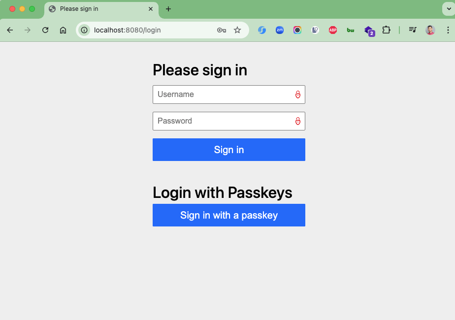
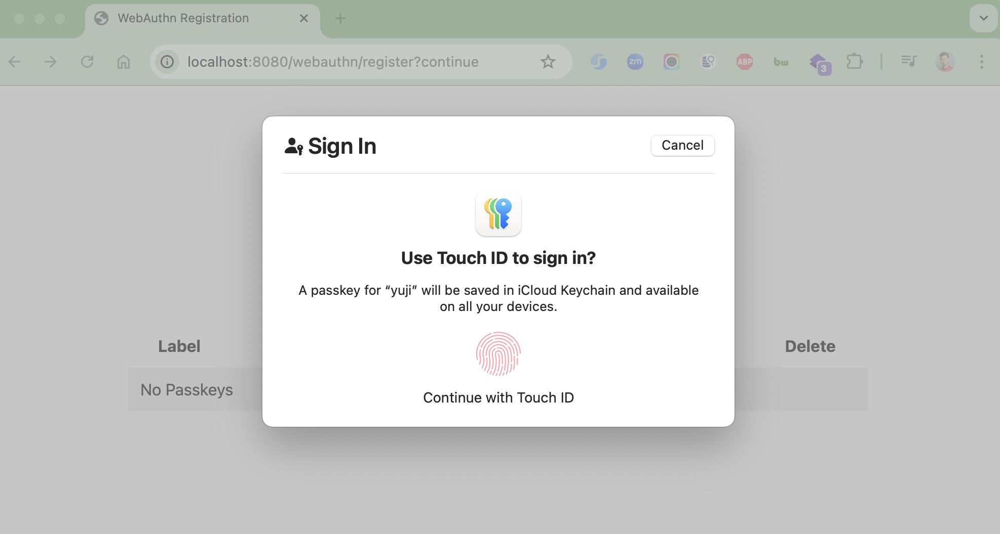
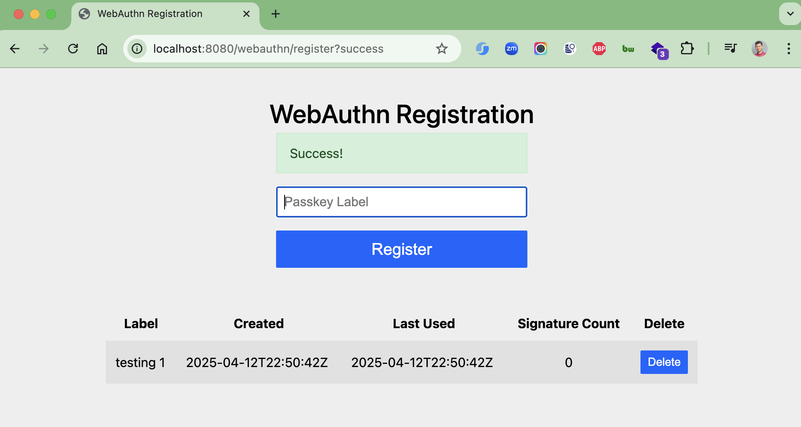
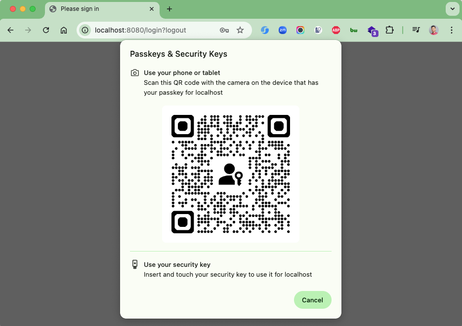
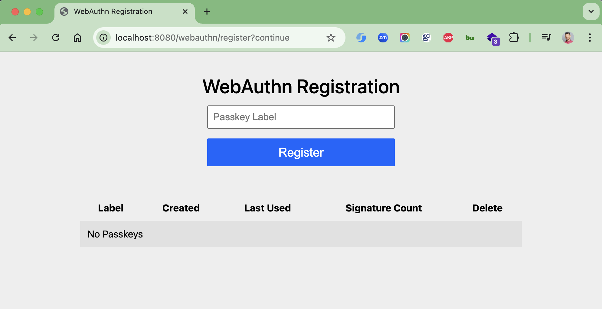

# spring-boot-passkey-auth

[](https://github.com/hendisantika/spring-boot-passkey-auth/actions/workflows/maven.yml)


Integrating Passkeys (WebAuthn) into Spring Security.

## Tech Stack

| Component        | Version                          |
|------------------|----------------------------------|
| Java             | 25                               |
| Spring Boot      | 4.1.2                            |
| Spring Security  | 7.1.x (incl. `spring-security-webauthn`) |
| WebAuthn4J       | 0.31.11.RELEASE                  |
| Build tool       | Maven (wrapper included)         |

## Requirements

- JDK 25 (e.g. [Eclipse Temurin](https://adoptium.net/) 25)
- No local Maven install needed — use the bundled `./mvnw` wrapper
- A browser/OS with passkey support (Chrome, Safari, Edge, Firefox; Touch ID, Windows Hello, Android, a security key, ...)

## Getting Started

```shell
git clone https://github.com/hendisantika/spring-boot-passkey-auth.git
cd spring-boot-passkey-auth

# build & run tests
./mvnw clean verify

# run the application
./mvnw spring-boot:run
```

Open http://localhost:8080 and log in with the demo user:

| Username | Password |
|----------|----------|
| `yuji`   | `1234`   |

Then register a passkey at http://localhost:8080/webauthn/register, log out (http://localhost:8080/logout) and
sign in again using **Sign in with a passkey**.

> [!NOTE]
> Users and passkeys are kept in memory, so registered passkeys are lost when the application restarts.

## 1. Introduction

Login forms have long been, and still are, a common feature of any web service that requires authentication to provide
its services. However, as security concerns started to become mainstream, it became clear that simple text passwords are
a weak spot: they can be guessed, intercepted, or leaked, leading to security incidents that can result in financial
and/or reputation damage.

Previous attempts to replace passwords with alternative solutions (mTLS, security cards, etc.) tried to address this
issue but led to poor user experience and additional costs.

In this project, we explore Passkeys, also known as WebAuthn, a standard that provides a secure alternative to
passwords, and show how to add support for this authentication mechanism to a Spring Boot application with Spring
Security.

## 2. What Is a Passkey?

Passkeys or WebAuthn is a standard API defined by the W3C that allows applications running in a web browser to manage
public keys and register them for use with a given service provider.

The typical registration scenario goes like this:

1. The user creates a new account on the service. The initial credentials are usually the familiar username/password.
2. Once registered, the user goes to their profile page and selects “create passkey”.
3. The system displays a passkey registration form.
4. The user fills in the form with the required information – e.g. a key label that will help select the right key
   later – and submits it.
5. The system saves the passkey and associates it with the user account. At the same time, the private part of this key
   is saved on the user’s device.
6. The passkey registration is complete.

Once registered, the user can use the stored passkey to access the service. Depending on the security configuration of
the browser and the user’s device, login will require a fingerprint scan, unlocking a smartphone, or a similar action.

A passkey consists of two parts: the public key that the browser sends to the service provider and a private part that
remains on the local device. The client-side API also ensures that a given passkey is usable only with the same site
that registered it.

## 3. Dependencies

```xml
<dependency>
    <groupId>org.springframework.boot</groupId>
    <artifactId>spring-boot-starter-web</artifactId>
</dependency>
<dependency>
    <groupId>org.springframework.boot</groupId>
    <artifactId>spring-boot-starter-security</artifactId>
</dependency>
<!-- Spring Security 7+: WebAuthn support lives in its own module -->
<dependency>
    <groupId>org.springframework.security</groupId>
    <artifactId>spring-security-webauthn</artifactId>
</dependency>
<dependency>
    <groupId>com.webauthn4j</groupId>
    <artifactId>webauthn4j-core</artifactId>
    <version>${webauthn4j.version}</version>
</dependency>
```

> [!IMPORTANT]
> WebAuthn support requires Spring Boot 3.4.0 or higher. Since Spring Security 7 (Spring Boot 4), the WebAuthn classes
> were moved out of `spring-security-web` into `spring-security-webauthn`. Without it the application fails to start
> with `NoClassDefFoundError: .../PublicKeyCredentialUserEntityRepository`.

## 4. Spring Security Configuration

The Spring Security configuration DSL has native support for passkeys through the `webAuthn()` method
(see [`SecurityConfig`](src/main/java/id/my/hendisantika/passkeyauth/config/SecurityConfig.java)):

```java
@Bean
public SecurityFilterChain securityFilterChain(HttpSecurity http) throws Exception {
    http
            .authorizeHttpRequests(req -> req.anyRequest().authenticated())
            .formLogin(Customizer.withDefaults())
            .webAuthn(webauthn -> webauthn
                    .rpName("Spring Security Relying Party")
                    .rpId("localhost")
                    .allowedOrigins("http://localhost:8080"));
    return http.build();
}
```

This is what we get with this configuration:

- A “Sign in with a passkey” button on the login page
- A registration page available at `/webauthn/register`

For proper operation, we must provide at least the following attributes to the WebAuthn configurer:

- `allowedOrigins`: external URL of the site, which MUST use HTTPS, unless it uses `localhost`
- `rpId`: application identifier, which MUST be a valid domain name that matches the hostname part of `allowedOrigins`
- `rpName`: a user-friendly name that the browser may use during the registration and/or login process

This configuration misses one aspect of production passkey support: registered keys are lost upon application restart,
because by default Spring Security uses an in-memory credential store. See [section 6](#6-passkey-repositories).

## 5. Passkey Walk-Through

1. Start the application with `./mvnw spring-boot:run` or from the IDE and navigate to http://localhost:8080.
2. The standard Spring login page now includes the “Sign in with a passkey” button. Since no key is registered yet, log
   in with the username/password credentials (`yuji` / `1234`).
3. Go to http://localhost:8080/webauthn/register, provide a label and click **Register**. What happens next depends on
   the device type and OS, but in the end a new key is added to the list. For instance, Chrome on Windows offers to
   store the key in the browser’s password manager or to use Windows Hello; macOS offers iCloud Keychain / Touch ID.
4. Log out at http://localhost:8080/logout, then click “Sign in with a passkey” on the login form and pick the passkey.
5. The device performs an additional authentication challenge (fingerprint, face recognition, PIN, ...). The private key
   signs a challenge which the server validates with the stored public key, and the login completes.

## 6. Passkey Repositories

To persist registered keys, provide implementations of the following interfaces:

- **`PublicKeyCredentialUserEntityRepository`** – manages `PublicKeyCredentialUserEntity` instances and maps user
  accounts managed by the `UserDetailsService` to user account identifiers (`name`, `id`, `displayName`). Both `name`
  and `id` are assumed unique within an authentication domain; entries typically have a 1:1 relationship with the
  accounts of the `UserDetailsService`.
- **`UserCredentialRepository`** – manages `CredentialRecord` instances, which store the public key received from the
  browser during registration, plus `userEntityUserId`, `label`, `lastUsed` and `created`. A `CredentialRecord` has an
  N:1 relationship with `PublicKeyCredentialUserEntity`, e.g. `findByUserId()` returns a list.

Spring Security also ships JDBC-based implementations (`JdbcPublicKeyCredentialUserEntityRepository`,
`JdbcUserCredentialRepository`) that can be registered as beans.

## 7. Testing

While it is possible to test passkey-based applications using mock requests, most failure scenarios are client-side,
so integration tests with a real browser are more valuable. With Selenium, the `VirtualAuthenticator` feature lets the
WebDriver simulate the authenticator:

```java
@BeforeEach
void setupTest() {
    VirtualAuthenticatorOptions options = new VirtualAuthenticatorOptions()
            .setIsUserVerified(true)
            .setIsUserConsenting(true)
            .setProtocol(VirtualAuthenticatorOptions.Protocol.CTAP2)
            .setHasUserVerification(true)
            .setHasResidentKey(true);

    driver = new ChromeDriver();
    authenticator = ((HasVirtualAuthenticator) driver).addVirtualAuthenticator(options);
}
```

A full happy-path test then covers: login with username/password → passkey registration → logout → login with the
passkey.

## CI/CD & Dependency Updates

- **GitHub Actions** ([`maven.yml`](.github/workflows/maven.yml)): builds and tests every push and pull request to
  `main` on Temurin JDK 25 using `./mvnw -B verify`, and submits the Maven dependency graph on pushes to `main`.
  It can also be triggered manually (`workflow_dispatch`).
- **Dependabot** ([`dependabot.yml`](.github/dependabot.yml)): checks Maven dependencies and GitHub Actions daily
  (05:00 Asia/Jakarta). Related updates are grouped (Spring Boot, Spring Security, WebAuthn4J, Maven plugins, other
  minor/patch bumps, all GitHub Actions), labelled, and use conventional commit prefixes (`build(deps)`, `ci(deps)`).

## Image Screenshots

Login Page



Signin Page



Success Page



Passkey Page



WebAuthn Page


